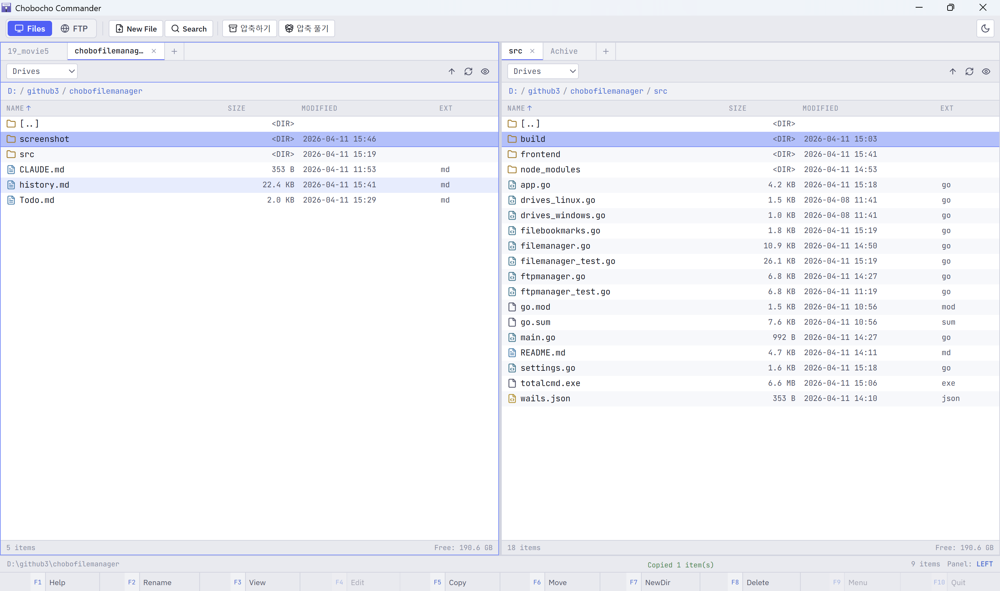
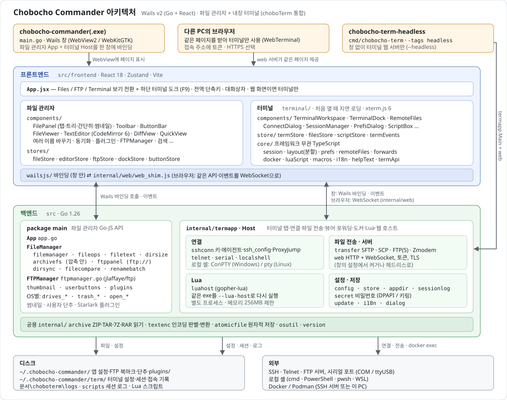

# Chobocho Commander

**Wails v2** (Go + React)로 만든 이중 패널 파일 관리자 (Total Commander Clone) + 내장 터미널 (choboTerm 통합)

한 창에서 **Files**(이중 패널 파일 관리자) · **FTP** · **Terminal**(SSH · Telnet · 시리얼 · 로컬 셸) 세 가지 보기를 오가고, 파일 패널 아래에는 **터미널 도크**(F9)를 띄울 수 있습니다. 터미널은 웹 서버를 켜서 다른 PC의 브라우저에서도 쓸 수 있습니다.



---

## 아키텍처



| 층 | 위치 | 역할 |
|----|------|------|
| 실행 파일 | `src/main.go` | Wails 창 하나에 파일 관리자 `App`과 터미널 `termapp.Host`를 함께 바인딩. 같은 exe를 `--lua-host`로 다시 실행하면 Lua 스크립트 호스트 |
| | `src/cmd/chobocho-term` | 헤드리스 터미널 (`-tags headless`): 창 없이 웹 서버만 |
| 프론트엔드 | `src/frontend/src` | React 18 + Zustand. `App.jsx`가 보기 전환·하단 도크·전역 단축키 담당 |
| | `components/`, `stores/` | 파일 관리자 화면 (패널, 뷰어, CodeMirror 6 에디터, FTP, 대화상자)과 상태 |
| | `terminal/` | 터미널 화면 (처음 열 때 지연 로딩, xterm.js 6). `core/`는 React와 무관한 TypeScript |
| 백엔드 | `src/*.go` (package main) | 파일 목록·복사/이동·휴지통·ZIP·텍스트 인코딩·Starlark·FTP 보기 |
| | `src/internal/termapp` | 터미널 탭·연결·파일 전송·포워딩·도커·Lua·웹 호스트 |
| | `src/internal/*` | 연결(`sshconn` `telnet` `serial` `localshell`), 전송(`transfer`), `web`, `luahost`, 설정·저장, 공용(`textenc` `atomicfile`) |

**프론트 ↔ 백엔드**: 창 안에서는 Wails 바인딩(`wailsjs/`)과 이벤트로, 다른 PC의 브라우저에서는 `internal/web`이 같은 페이지를 내려 주고 `web_shim.js`가 같은 API·이벤트를 WebSocket으로 전달합니다 (브라우저 화면은 터미널만).

다이어그램 원본: [docs/architecture.svg](docs/architecture.svg) · 터미널 통합 설계: [docs/choboterm-integration.md](docs/choboterm-integration.md)

---

## 주요 기능

### 파일 관리자 (Files 보기)
- 이중 패널 (좌 / 우), 패널마다 탭 (Ctrl+T / Ctrl+W / Ctrl+Tab), 탭·경로는 다음 실행 때 복원
- 키보드 탐색: 방향키 · vim(`h j k l`) · WASD, Shift+글자로 빠른 이동, `-`로 이전 폴더
- 복사 (F5), 이동 (F6) — 같은 이름은 덮어쓰기 / 이름 바꾸기 (복사는 건너뛰기도)를 물어봄
- 휴지통 (F8 / Del), 영구 삭제 (Shift+Del), 새 폴더 (F7), 새 파일 (Ctrl+N), 이름 바꾸기 (F2)
- 다중 선택 (Ctrl+Click, Shift+Click, Space, Insert, Ctrl+A), 파일 검색 (Ctrl+F, 하위 폴더까지), 바로가기 (Ctrl+D)
- 숨김 파일 토글 (Ctrl+H), 경로 표시줄 (클릭 가능한 브레드크럼), 드라이브 / 마운트 포인트 선택기
- **내장 뷰어 (F3)**: 텍스트(인코딩 자동 판별, 조합형 포함) · 이미지(확대/축소, ←/→ 넘기기) · 마크다운 렌더링(GitHub 이미지는 로컬 저장소 파일로)
- **내장 에디터 (F4)**: CodeMirror 6, 구문 강조, 찾기, 인코딩 선택 저장, 32MB까지, F3 ↔ F4 전환
- ZIP 압축 / 압축 해제, 명령 실행 창 (Ctrl+O), Starlark 스크립트 (Ctrl+M 스크래치, 에디터에서 F5 실행)

### 터미널 (Terminal 보기 · 하단 도크)
- **연결**: SSH(키 · 에이전트 · ssh_config · ProxyJump · OTP 질문), Telnet, FTP, 시리얼(COM / ttyUSB), 로컬 셸(cmd / PowerShell / pwsh / WSL)
- 화면 분할 (Ctrl+Shift+\\ / -), 탭 우클릭 메뉴, 스크롤백 검색 (Ctrl+Shift+S), 키워드 강조, 자동 재접속
- 세션 관리자 (Ctrl+Shift+H, PuTTY 가져오기), 설정 (Ctrl+Shift+O), 매크로 (Ctrl+Shift+M, F키), 세션 로그 (Ctrl+Shift+L), 메모장 (Ctrl+Shift+B)
- **원격 파일 창** (Ctrl+Shift+F, SFTP / SCP / FTP): 받기 / 올리기 · 이어받기, 즐겨찾기, 원격 파일 보기 · 편집 (F3 / F4), 파일 패널 폴더로 받기 / 패널의 선택 항목 올리기
- 포트 포워딩 (Ctrl+Shift+P, -L / -R / -D), 도커 컨테이너 (Ctrl+Shift+J), Lua 콘솔 (Ctrl+Shift+K) · 스크립트, Zmodem (sz / rz)
- 영어 화면, 창 투명도, 업데이트 확인, 고양이 🐈
- **웹 서버**: 설정에서 켜면 다른 PC의 브라우저에서 이 PC의 터미널 사용 (토큰, HTTPS 선택). 창 없이 쓰려면 헤드리스 실행 파일
- **하단 도크 (F9)**: 활성 패널 폴더에서 셸 시작, 패널 따라가기(cd), Ctrl+Enter / Ctrl+Shift+Enter로 파일 이름 / 경로 붙여넣기, 셸 폴더를 패널에서 열기

### FTP 클라이언트 (FTP 보기)
- FTP / FTPS(AUTH TLS) 서버 연결, 접속 기록, 북마크 (`~/.chobocho-commander/ftp_bookmarks.json`)
- 다운로드 / 업로드 / 삭제 / 디렉토리 생성 / 이름 변경, 패시브 모드, 같은 이름은 덮어쓸지 물어봄
- 왼쪽 위 FTP 버튼은 터미널 설정(Ctrl+Shift+O → 파일 관리자)에서 숨길 수 있음

### 도움말 (F1)
- **Files 보기**: 파일 관리자 단축키 표 (탐색 · 선택 · 탭 · 보기/편집 · 터미널 도크 · 압축 · 기타)
- **Terminal 보기**: 터미널 전체 도움말 (한국어 / English, Alt+L로 전환)

### UI
- 다크 / 라이트 테마, JetBrains Mono 폰트
- F-key 단축키 바 (Total Commander 클래식 스타일), 하단 상태 바 (파일 수, 선택 정보)

---

## 개발 환경 요구사항

| 도구 | 버전 |
|------|------|
| Go | 1.26+ |
| Node.js | 24 (npm 11, CI와 같게 — lock 파일 해석이 npm 버전마다 다름) |
| Wails CLI | v2.11+ |

### Wails CLI 설치
```bash
go install github.com/wailsapp/wails/v2/cmd/wails@latest
```

### 플랫폼별 의존성
- **Windows**: WebView2 런타임 (Windows 10/11에 기본 포함), 로컬 셸은 Windows 10 1809 이상 (ConPTY)
- **Linux**: `webkit2gtk-4.0`, `gtk3`, `pkg-config`

```bash
# Ubuntu/Debian
sudo apt install libwebkit2gtk-4.0-dev libgtk-3-dev pkg-config

# Fedora
sudo dnf install webkit2gtk4.0-devel gtk3-devel
```

---

## 개발 실행

```bash
cd src

# 개발 모드 실행 (핫 리로드, frontend/wailsjs 바인딩도 생성)
wails dev
```

---

## 빌드

```bash
# Windows: 프론트·Go 테스트 → wails build → release\ 에 복사 (+ 헤드리스 터미널)
build.bat

# Linux
./build_linux.sh

# 직접 빌드
cd src
wails build -platform windows/amd64
wails build -platform linux/amd64
go build -tags headless -o chobocho-term-headless.exe ./cmd/chobocho-term
```

결과물: `release/chobocho-commander(.exe)`, `release/chobocho-term-headless(.exe)`

버전은 `src/internal/version` 한 곳 (빌드 때 `-ldflags "-X totalcmd/internal/version.Version=…"`로 덮어쓰기 가능), 프론트 `package.json`의 버전과 같아야 합니다 (테스트가 검사).

**헤드리스 터미널** (`chobocho-term-headless`): 창 없이 터미널 웹 서버만 띄웁니다 (WebView2 · GTK 불필요).
`chobocho-term-headless --headless` → 출력된 주소(토큰 포함)를 브라우저로 열면 터미널을 씁니다. 설정 · 세션은 앱과 같은 `~/.chobocho-commander/term`.

---

## 테스트 · 측정

```bash
cd src && go test ./...                  # Go
cd src/frontend && npm test              # 프론트 (vitest)
cd src/frontend && npm run typecheck     # 터미널 코어 타입 검사
cd src/frontend && npm run bench         # 뷰어/에디터 성능 (헤드리스 Edge/Chrome)
cd src/frontend && npm run bench:term    # 터미널 출력 처리량·키 입력 지연
cd src/frontend && npm run e2e:terminal  # wails dev 실행 중일 때 실제 백엔드 종단 점검
```

CI(`.github/workflows/ci.yml`): PR과 master 푸시마다 Windows · Linux에서 Wails 바인딩 생성(`wails generate module`), 프론트 타입 검사 · 테스트 · 빌드, Go vet · 테스트, 헤드리스 빌드.

---

## 키보드 단축키

### 파일 관리자 (Files 보기)

| 키 | 동작 |
|----|------|
| `↑` / `↓`, `j` / `k`, `w` / `s` | 커서 이동 |
| `Tab`, `h` / `a`, `l` / `d` | 패널 전환 / 왼쪽 패널 / 오른쪽 패널 |
| `Shift+글자` | 그 글자로 시작하는 파일로 (다시 누르면 다음) |
| `Enter` | 열기 / 디렉토리 진입 |
| `Backspace` / `-` | 상위 디렉토리 / 이전에 있던 폴더 |
| `Space` / `Insert` | 선택 토글 / 선택 토글 + 아래로 |
| `Ctrl+A` | 전체 선택 |
| `Ctrl+T` / `Ctrl+W` / `Ctrl+Tab` / `Ctrl+Shift+Tab` | 새 탭 / 탭 닫기 / 다음 탭 / 이전 탭 |
| `F1` | 도움말 |
| `F2` | 이름 변경 |
| `F3` / `F4` | 보기 / 편집 |
| `F5` / `F6` | 반대 패널로 복사 / 이동 |
| `F7` | 새 디렉토리 |
| `F8` / `Del` / `Shift+Del` | 휴지통 / 휴지통 / 영구 삭제 |
| `F9` / `Shift+F9` | 하단 터미널 도크 / 바깥 명령 창 |
| `Ctrl+Enter` / `Ctrl+Shift+Enter` | 커서 파일 이름 / 전체 경로를 도크 셸에 붙여넣기 |
| `Ctrl+N` | 새 파일 |
| `Ctrl+F` / `Ctrl+D` | 파일 검색 / 바로가기 |
| `Ctrl+H` / `Ctrl+R` | 숨김 파일 토글 / 새로 고침 |
| `Ctrl+Shift+C` | 커서 파일 경로를 클립보드로 |
| `Ctrl+O` / `Ctrl+M` | 명령 실행 창 / Starlark 스크래치 |

### 뷰어 · 에디터 (F3 / F4)

| 키 | 동작 |
|----|------|
| `F3` ↔ `F4` | 뷰어 ↔ 에디터 전환 (뷰어에서 F3: 닫기) |
| `Ctrl+F` | 찾기 (Enter 다음, Shift+Enter 이전) |
| `Ctrl+S` | 저장 (에디터) |
| `F5` / `Ctrl+Enter` | `.star` 파일 실행 (에디터) |
| `←` / `→` | 같은 폴더의 이전 / 다음 이미지 |
| `Ctrl` + `+` / `-` / `0`, `Ctrl+휠` | 이미지 확대 / 축소 / 맞춤 |
| `h` `j` `k` `l` | 확대한 이미지 스크롤 |
| `Esc` | 닫기 (저장 안 한 내용은 물어봄) |

### 터미널 (Terminal 보기)

| 키 | 동작 |
|----|------|
| `Ctrl+Shift+T` / `W` | 새 탭 / 탭 닫기 |
| `Ctrl+Tab` / `Ctrl+Shift+Tab` | 다음 / 이전 탭 |
| `Ctrl+Shift+\` / `-` | 옆으로 / 아래로 분할, `Alt+방향키` 칸 이동 |
| `Ctrl+Shift+C` / `V` | 복사 / 붙여넣기 (선택하면 바로 복사, 우클릭 붙여넣기) |
| `Ctrl+Shift+F` | 원격 파일 창 |
| `Ctrl+Shift+H` / `O` / `M` | 세션 관리 / 설정 / 매크로 |
| `Ctrl+Shift+P` / `J` / `K` | 포트 포워딩 / 도커 / Lua 콘솔 |
| `Ctrl+Shift+L` / `B` / `S` | 세션 로그 / 메모장 / 찾기 |
| `Ctrl+Shift+D` / `E` | 연결 끊기 / UTF-8 ↔ EUC-KR |
| `Ctrl+=` / `-` / `0`, `Ctrl+휠` | 글꼴 크기 |
| `F1` | 터미널 도움말 (한국어 / English) |

---

## 프로젝트 구조

```
src/
├── main.go                 # Wails 진입점: 파일 관리자 App + 터미널 termapp.Host 바인딩, --lua-host 하위 프로세스
├── app.go                  # 파일 관리자 Go-JS API
├── filemanager.go          # 파일 목록·정보·검색
├── fileops.go transfer.go  # 복사/이동/삭제 (같은 경로·덮어쓰기 안전 처리)
├── filetext.go             # 텍스트·이미지 읽기/쓰기 (internal/textenc), Starlark 실행
├── filearchive.go          # ZIP 압축·해제
├── fileshell.go            # 열기·셸 명령 실행
├── filebookmarks.go settings.go fileutil.go repoimage.go
├── drives_* trash_* open_* # OS별 드라이브·휴지통·열기
├── ftpmanager.go           # FTP 보기 클라이언트 (FTPS 포함)
├── cmd/chobocho-term/      # 헤드리스 터미널 웹 서버 (-tags headless)
├── internal/
│   ├── termapp/            # 터미널 Host: 탭·연결·파일 전송·뷰어·포워딩·도커·Lua·웹 (Wails 바인딩)
│   ├── sshconn/ telnet/ serial/ localshell/   # 연결 종류 (localshell: ConPTY / pty)
│   ├── transfer/           # SFTP / SCP / FTP(S) / Zmodem
│   ├── web/                # 웹 서버 (HTTP + WebSocket, 토큰, TLS, web_shim.js)
│   ├── luahost/            # Lua 스크립트 (별도 프로세스)
│   ├── config/ store/ secret/ appdir/ sessionlog/ update/ i18n/ dialog/
│   ├── textenc/ atomicfile/                    # 인코딩 판별·변환(조합형 포함), 원자적 저장·손상 파일 보관
│   └── terminal/ codec/ osutil/ version/ dbg/ testutil/
└── frontend/
    ├── bench/              # 성능 측정 (뷰어/에디터, 터미널), 실제 백엔드 종단 점검
    └── src/
        ├── App.jsx         # 최상위 (Files / FTP / Terminal 보기 + 하단 도크, 전역 단축키)
        ├── components/     # FilePanel, FileViewer, TextEditor, FTPManager, HelpDialog, 대화상자 ...
        ├── stores/         # fileStore, editorStore, ftpStore, dockStore, themeStore
        ├── utils/ styles/ test/
        └── terminal/       # 터미널 화면 (처음 열 때 지연 로딩, xterm 6)
            ├── core/       # 프레임워크 무관 TS: 세션, 분할, 설정, 원격 파일·소스, 포워딩, 도커, Lua, i18n, 도움말 ...
            ├── store/      # termStore, filesStore, scriptStore, termEvents (zustand)
            └── components/ # TerminalWorkspace, TerminalDock, ConnectDialog, RemoteFiles, TerminalHelp ...
docs/architecture.svg       # 아키텍처 다이어그램
docs/choboterm-integration.md   # 터미널 통합 설계·계획
examples/gwbasic.star       # Starlark 예제
tools/gen_notices.py        # THIRD_PARTY_NOTICES.txt 생성
```

---

## 기술 스택

| 분류 | 기술 | 버전 |
|------|------|------|
| 백엔드 | Go | 1.26 |
| 데스크톱 프레임워크 | Wails | v2.11 |
| FTP | jlaffaye/ftp | v0.2.4 |
| SSH / SFTP | golang.org/x/crypto, pkg/sftp | |
| 로컬 셸 (Linux) | creack/pty | v1.1 |
| 웹 서버 | gorilla/websocket | v1.5 |
| Lua / Starlark | gopher-lua v1.1, go.starlark.net | |
| UI 라이브러리 | React | 18 |
| 상태 관리 | Zustand | v4 |
| 에디터 | CodeMirror | 6 |
| 터미널 | xterm.js | 6 |
| 마크다운 | marked + DOMPurify | |
| 빌드 · 테스트 | Vite v4, Vitest v4, TypeScript 5 | |
| 아이콘 | lucide-react | v0.383 |

서드파티 라이선스: [THIRD_PARTY_NOTICES.txt](THIRD_PARTY_NOTICES.txt) (`python tools/gen_notices.py`로 다시 생성)

---

## 설정 파일

- 앱 설정 · 패널 탭: `~/.chobocho-commander/`
- FTP 북마크: `~/.chobocho-commander/ftp_bookmarks.json`
- 터미널 설정 · 세션 · 접속 기록: `~/.chobocho-commander/term/` (처음 실행 때 기존 choboTerm 설정을 복사)
- 세션 로그 / Lua 스크립트: `문서\choboterm\logs`, `문서\choboterm\scripts`
- 다운로드 · Zmodem 수신: 기본 `~/Downloads`
